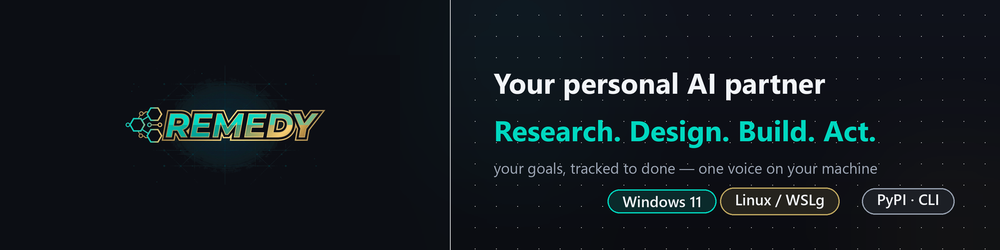

# Remedy

<p align="center">
  
</p>

<p align="center">
  <em>A partner for any ability level</em> — she drives this computer to finish the goal you set.
</p>

<p align="center">
  <a href="https://github.com/AhmiDarrow/RemedyAI/releases/latest"><strong>Download for Windows</strong></a>
  ·
  <a href="https://github.com/AhmiDarrow/RemedyAI/releases/latest">Download for macOS</a>
  ·
  <a href="https://github.com/AhmiDarrow/RemedyAI/blob/master/docs/manual/01-install-linux.md">Install on Linux</a>
  ·
  <a href="https://github.com/AhmiDarrow/RemedyAI/blob/master/docs/manual/00-overview.md">Owner’s manual</a>
  ·
  <a href="https://github.com/AhmiDarrow/RemedyAI/blob/master/docs/manual/13-whats-new.md">What’s new</a>
  ·
  <code>pip install remedy-ai</code>
</p>

**Not** a medical product. **F1** (or **Ctrl+/**) opens the same Help wiki inside the app.

---

Remedy lives on **this computer**. The Desktop app runs on **Windows x64**, **Linux** (including WSLg), and **macOS** (Apple Silicon and Intel). The CLI also runs on **Windows ARM64** and **Linux ARM64**. **Grove** is home. **Studio** is the workbench. Continuity is `~/.remedy`. You bring the model (cloud keys or **RMB** locally). Money, passwords, submit, send, and delete **stop for you**.

| | |
|--|--|
| **Latest release** | [](https://github.com/AhmiDarrow/RemedyAI/releases/latest) · [](https://pypi.org/project/remedy-ai/) |
| **Source on `master`** | [](https://github.com/AhmiDarrow/RemedyAI/blob/master/CHANGELOG.md) · [What’s new](https://github.com/AhmiDarrow/RemedyAI/blob/master/docs/manual/13-whats-new.md) |
| **Owner’s manual** | [docs/manual/](https://github.com/AhmiDarrow/RemedyAI/tree/master/docs/manual/) · [index](https://github.com/AhmiDarrow/RemedyAI/blob/master/docs/manual/README.md) |
| **Install** | [Windows](https://github.com/AhmiDarrow/RemedyAI/blob/master/docs/manual/01-install-windows.md) · [Linux](https://github.com/AhmiDarrow/RemedyAI/blob/master/docs/manual/01-install-linux.md) · macOS Desktop from [Releases](https://github.com/AhmiDarrow/RemedyAI/releases/latest) · CLI via `pip install remedy-ai` |
| **Security / data** | [04-security-and-data](https://github.com/AhmiDarrow/RemedyAI/blob/master/docs/manual/04-security-and-data.md) |
| **Commands / keys** | [11-reference-commands](https://github.com/AhmiDarrow/RemedyAI/blob/master/docs/manual/11-reference-commands.md) · [12-reference-shortcuts](https://github.com/AhmiDarrow/RemedyAI/blob/master/docs/manual/12-reference-shortcuts.md) |
| **Changelog** | [CHANGELOG.md](https://github.com/AhmiDarrow/RemedyAI/blob/master/CHANGELOG.md) |

Local API: `127.0.0.1:7400`. Close ✕ hides to the **tray** on Windows, the **menu bar** on macOS, and **minimizes** on Linux/WSLg. `pip install remedy-ai` then `remedy serve` downloads a checksum-verified `remedy-runtime` and `remedy_core` for this OS from GitHub Releases on first run (cached in `~/.remedy/runtime/`).

From the creator: *My name is Ahmi, I hope you enjoy my Remedy.*

---

## Supported platforms

These are the platforms with published assets on the [latest GitHub release](https://github.com/AhmiDarrow/RemedyAI/releases/latest). The table lists only triples that shipped and whose checksums were verified against `remedy-native-SHA256SUMS.txt`.

| Platform | Desktop app | CLI (`pip install remedy-ai`) |
|----------|-------------|-------------------------------|
| Windows x64 | Yes — `Remedy.Desktop_*_x64-setup.exe` | Yes |
| Windows ARM64 | — | Yes |
| Linux x86_64 | Yes — AppImage and `.deb` | Yes |
| Linux arm64 | — | Yes |
| macOS arm64 (Apple Silicon) | Yes — unsigned `Remedy.Desktop_*_aarch64.dmg` | Yes |
| macOS x86_64 (Intel) | Yes — unsigned `Remedy.Desktop_*_x64.dmg` | Yes |

There is no Windows ARM64 Desktop installer in this release. macOS builds are ad-hoc signed and not notarized.

### Install

**Windows x64 (Desktop).** Download [`Remedy.Desktop_*_x64-setup.exe`](https://github.com/AhmiDarrow/RemedyAI/releases/latest), run the installer, and launch from the Start Menu or the desktop shortcut. Details: [Install on Windows](https://github.com/AhmiDarrow/RemedyAI/blob/master/docs/manual/01-install-windows.md).

**Linux x86_64 (Desktop).** From the same [Releases](https://github.com/AhmiDarrow/RemedyAI/releases/latest) page:

- **`.deb`** (Debian/Ubuntu): `sudo apt install ./Remedy.Desktop_*_amd64.deb`
- **AppImage:** `chmod +x Remedy.Desktop_*.AppImage && ./Remedy.Desktop_*.AppImage`

Details: [Install on Linux](https://github.com/AhmiDarrow/RemedyAI/blob/master/docs/manual/01-install-linux.md).

**macOS (Desktop, Apple Silicon and Intel).** From the same [Releases](https://github.com/AhmiDarrow/RemedyAI/releases/latest) page, download `Remedy.Desktop_*_aarch64.dmg` (Apple Silicon) or `Remedy.Desktop_*_x64.dmg` (Intel). Open the disk image and drag Remedy Desktop to Applications. This build is unsigned (ad-hoc codesign, no Apple notarization). First launch: right-click the app and choose Open, or clear quarantine:

```bash
xattr -dr com.apple.quarantine "/Applications/Remedy Desktop.app"
```

In-app updates use the minisign-signed `.app.tar.gz` from the same release.

**CLI on Windows (x64 and ARM64), Linux (x86_64 and arm64), and macOS (arm64 and x86_64):**

```bash
pip install remedy-ai
remedy serve
```

Then open `http://127.0.0.1:7400`. First run downloads the checksum-verified `remedy-runtime` / `remedy_core` pair for this OS and caches them under `~/.remedy/runtime/` (or `%USERPROFILE%\.remedy\runtime\` on Windows). No Go or Zig toolchain is required. HQ voice reference clips download into `~/.remedy/voice/references/` on first use.

---

## Development

```bash
git clone https://github.com/AhmiDarrow/RemedyAI.git && cd RemedyAI
uv sync --group dev
uv run ruff check .
uv run mypy
uv run pytest -q
cd desktop && npm test && npm run build
cd ../desktop/src-tauri && cargo test --locked
cd ../../native/go && go test -race ./... && go vet ./...
cd ../zig && zig build test -Doptimize=ReleaseSafe
cd ../../android && ./gradlew testDebugUnitTest lintDebug assembleDebug assembleRelease
cd .. && uv run python scripts/check_docs.py && uv build
```

Before a push, the same matrix runs locally as the pre-push gate: `uv run python scripts/prepush.py`
(enable once per clone with `git config core.hooksPath .githooks`). Windows uses `gradlew.bat`;
Go race detection also runs on Linux CI. CI exercises Python
3.12/3.13, a Windows-sensitive pytest surface, the React SPA, both Tauri targets,
RemedyConnect Android, the Go/Zig native runtime, and Python packaging.

Version / help / docs / sanitize gates: `scripts/sync_version.py` · `scripts/sync_help_manual.py` · `scripts/check_docs.py` · `scripts/check_sanitize.py`.  
Contributing: [CONTRIBUTING.md](https://github.com/AhmiDarrow/RemedyAI/blob/master/CONTRIBUTING.md) · signing: [WINDOWS_SIGNING.md](https://github.com/AhmiDarrow/RemedyAI/blob/master/docs/WINDOWS_SIGNING.md)

---

## Support

[patreon.com/cw/AhmiDarrow](https://www.patreon.com/cw/AhmiDarrow)

## License

**Apache License 2.0** — [LICENSE](https://github.com/AhmiDarrow/RemedyAI/blob/master/LICENSE) · [NOTICE](https://github.com/AhmiDarrow/RemedyAI/blob/master/NOTICE)

Free to use, modify, and redistribute, including commercially. Use is at your own risk; see [TERMS](https://github.com/AhmiDarrow/RemedyAI/blob/master/docs/TERMS.md). Third-party notices: `desktop/public/THIRD_PARTY_NOTICES.txt`.

Copyright © 2025–2026 **Ahmi Darrow**.
